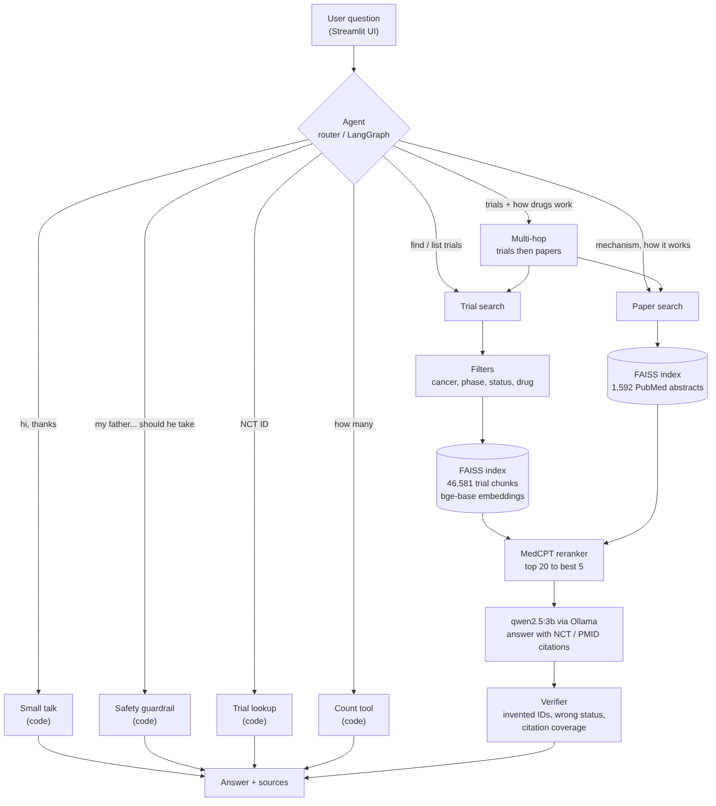

# Agentic Clinical Research Assistant

A biomedical research assistant that answers oncology questions using **ClinicalTrials.gov** trials and **PubMed** papers, with every claim linked to a source (`[NCT…]` / `[PMID …]`). It uses **only open-source models running locally**, with no proprietary hosted LLM APIs.

> **Research use only. Not medical advice.** Personal treatment questions are refused by a safety guardrail.

---

## What it does

| Question type | Example | How it is answered |
|---|---|---|
| Trial lookup | "Tell me about NCT05086614." | Record read directly from the data (code, no LLM) |
| Trial search | "Find recruiting Phase 3 lung cancer trials." | Metadata filters + dense/BM25 search + MedCPT reranker + LLM |
| Counting | "How many recruiting pancreatic cancer trials are there?" | Count tool over all 4,407 trials (code) |
| Drug mechanism | "What is the mechanism of action of osimertinib?" | PubMed paper search + LLM with PMID citations |
| Multi-hop | "Which recruiting melanoma trials test pembrolizumab, and how does it work?" | Trial search → drug extraction → paper search, merged |
| Personal advice | "Which treatment should my father take?" | Fixed safety refusal (no search, no LLM) |

---

## Architecture


```text
Question
  ├─ Small talk / Safety guardrail / Trial-ID lookup        (rules, instant)
  ├─ Planner: keyword router  OR  LangGraph agent (LLM picks the tool)
  ├─ Tools: count · trial search · paper search · multi-hop
  │     Trial search: metadata filters → dense (bge + FAISS) ∪ BM25 (RRF) → MedCPT reranker
  ├─ qwen2.5:3b writes the answer with [NCT]/[PMID] citations
  ├─ Citation check: every cited ID must be in the retrieved sources
  └─ Verifier: invented citations · trial-status claims · citation coverage
→ Answer + sources + agent trace (shown in the UI)
```

LangGraph agent loop: `plan → act → check (retry with another tool if no valid citations) → verify → answer`.

---

## Data and models

| Item | Details |
|---|---|
| Trials | 4,407 oncology trials (10 cancer types) from ClinicalTrials.gov API v2 → 46,581 chunks (summary / eligibility / outcomes, 500 chars, 100 overlap) |
| Papers | 1,592 PubMed abstracts (cancer reviews + 25 oncology drugs) via E-utilities |
| LLM | `qwen2.5:3b` via Ollama, temperature 0 |
| Embeddings | `BAAI/bge-base-en-v1.5` (768-dim), FAISS `IndexFlatIP` |
| Lexical search | BM25 (`rank-bm25`), fused with dense results by Reciprocal Rank Fusion |
| Reranker | `ncbi/MedCPT-Cross-Encoder` (biomedical cross-encoder) |
| Agent framework | LangGraph |
| Hardware | Intel i5-1235U, 16 GB RAM, CPU only |

---

## Results (summary)

**Main test set:** 10 questions, 30 gold trials, 20 key facts.

| Variant | Gold trials cited | Key facts | Invented citations |
|---|---|---|---|
| LLM-only | 0/30 | 8/20 | 0 |
| Naive RAG | 9/30 | 5/20 | 0 |
| Advanced RAG (filters + fact sheets) | 19/30 | 10/20 | 0 |
| Agentic (tools + code details + PubMed) | 23/30 | 18/20 | 0 |

**Hard test set:** paraphrased questions without obvious keywords, with gold answers computed from the data.

| | Keyword router | LangGraph agent |
|---|---|---|
| Key facts | 3/14 | 11/14 |
| Correct tool chosen | 3/11 | 8/11 |

**Retrieval experiment** (trial-level, 12 questions with gold trials):

| Method | Recall@5 | Recall@10 | MRR |
|---|---|---|---|
| Dense | 0.449 | 0.474 | 0.575 |
| BM25 | 0.428 | 0.580 | 0.497 |
| Hybrid (RRF) | 0.387 | 0.572 | 0.598 |

Full tables: `reports/comparison.md`, `reports/comparison_hard.md`, `reports/retrieval_experiment.md`.

---

## Setup (local)

```powershell
git clone https://github.com/vijaya-842/Agentic-Clinical-Research-Assistant.git
cd Agentic-Clinical-Research-Assistant
py -3.11 -m venv .venv
.venv\Scripts\Activate.ps1
pip install -r requirements.txt
ollama pull qwen2.5:3b
```

### Build the data and indexes (once)

```powershell
python -m src.ingestion.clinicaltrials_fetcher     # download trials      -> data/raw/
python -m src.ingestion.trial_chunks               # make chunks          -> data/processed/
python -m src.embeddings.build_faiss_index         # trial index (about 14 h on CPU)
python -m src.ingestion.pubmed_fetcher             # download papers      -> data/raw/
python -m src.embeddings.build_pubmed_index        # paper index
```

The BM25 index is built automatically on first use (`data/index/bm25_trials.pkl`).

### Run the app

```powershell
streamlit run src/ui/app.py
```

Open http://localhost:8501. The sidebar switches between the LangGraph agent and the keyword router.

---

## Run with Docker

Docker Desktop must be running.

```powershell
docker compose up -d --build
docker compose exec ollama ollama pull qwen2.5:3b   # first time only
```

Open http://localhost:8501. Two containers run: `app` (Streamlit + agents) and `ollama` (LLM). The `data/` folder is mounted, not copied.

---

## Evaluation

```powershell
python -m src.agents.router_agent                         # main set, keyword router
python -m src.agents.langgraph_agent                      # main set, LangGraph agent
python -m scripts.build_hard_questions                    # hard set with code-computed gold
python -m src.agents.langgraph_agent --questions eval/questions_hard.json --output eval/hard_langgraph_results.json
python -m src.evaluation.compare                          # main comparison table
python -m src.evaluation.compare --hard                   # hard-set comparison
python -m scripts.retrieval_experiment                    # Dense vs BM25 vs Hybrid
python -m scripts.find_duplicate_chunks                   # data quality audit
```

Use `--no-hybrid` with either agent to run dense-only search.

## Tests

```powershell
python -m pytest tests/ -q
```

About 124 unit tests, using fake models and data so they run in seconds.

---

## Project structure

```text
configs/          model and retrieval settings
data/             raw/, processed/, index/   (not in Git)
eval/             test questions and result files
reports/          comparison reports
scripts/          hard-question builder, retrieval experiment, duplicate audit
src/ingestion/    ClinicalTrials.gov + PubMed fetchers, chunking
src/embeddings/   FAISS index builders
src/retrieval/    dense, advanced (filters), BM25, hybrid, PubMed search, pipeline
src/reranking/    cross-encoder reranker
src/rag/          naive, advanced (fact sheets), literature RAG
src/tools/        count, trial lookup, small talk
src/agents/       keyword router, LangGraph agent, multi-hop, verifier
src/evaluation/   scoring and retrieval metrics
src/ui/           Streamlit app
docker/           Dockerfile
tests/            unit tests
```

---

## Project status

- [x] Data ingestion (ClinicalTrials.gov, PubMed) and chunking
- [x] Embeddings and FAISS indexes
- [x] LLM-only baseline, Naive RAG, Advanced RAG (filters, fact sheets)
- [x] Tools: count, trial lookup, small talk, safety guardrail
- [x] Agents: keyword router and LangGraph agent (plan → act → check → verify)
- [x] Multi-hop questions (trials + papers)
- [x] Critic / verifier
- [x] MedCPT reranker
- [x] BM25 + hybrid retrieval experiment
- [ ] Hybrid search measured end-to-end in the full pipeline (in progress)
- [x] Evaluation: main set, hard set, retrieval metrics
- [x] Streamlit UI and Docker Compose
- [ ] 100-question frozen benchmark + full metrics report
- [ ] Logging, error handling, negative tests
- [ ] Final report and presentation

## Known limitations

- Small evaluation sets so far (10 + 13 questions); ±1 point differences are noise.
- CPU only: about 30–110 s per LLM call; multi-hop questions take about 5 minutes.
- Eligibility questions (e.g. "exclude brain metastases") remain the weakest.
- The verifier checks citations and trial status, not every kind of claim.